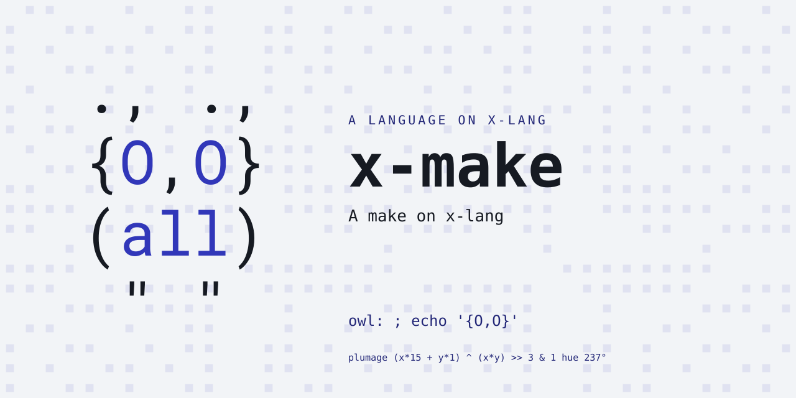
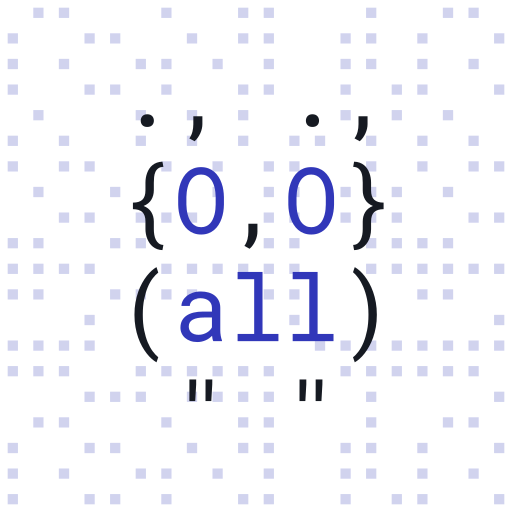

# x-make

A make on x-lang -- the fourth and last tool of the self-hosting arc's
core set (awk, grep, sed, make).  Deliberately SELF-CONTAINED: make is
the bootstrap's root tool, so this bundle requires no other lang.

The aim is the middle ground between GNU make, BSD make and the others:
the readings they share, POSIX's where it has one.  A Makefile here
should not need a reading only one of them has; when one does, the
Makefile moves, not this make.  The scope today is the measured one,
what x-lang's own Makefiles use (see `docs/bootstrap-closure.md` for the
measurement method), and some of that is GNU's alone.
Working: rules with prerequisites and tab recipes; `=`, `:=`, `?=`,
`+=`, `!=`; `$(VAR)`, `$X`, `$$`, computed names, the suffix
substitution `$(VAR:.c=.o)`; the functions `shell` `wildcard`
`findstring` `if` `subst` `patsubst` `basename` `dir` `notdir` `strip`;
`ifeq`/`ifneq`/`ifdef`/`ifndef`/`else`/`endif`; `include`/`-include`;
suffix rules (`.c.o:`, `.c:`, over `.SUFFIXES`) and pattern rules
(`%.o: %.c`), an explicit rule with no recipe taking an implicit one's,
with `$@ $< $^ $* $?`; `.PHONY`, `.SILENT`; a `FORCE:` prerequisite;
`CC` defaulting to `cc`; `SHELL` naming the shell recipes run under
(`/bin/sh` unless the makefile or the command line says otherwise; the
environment's `SHELL` is never read, as GNU make and BSD make leave it);
the environment as defaults the makefile overrides; backslash-newline
in POSIX's two readings (one space outside a recipe, kept inside one);
mtime-driven rebuilds (whole-second granularity); `@` and `-` recipe
prefixes; `-C`, `-f`, `-n`, `-s`,
`-e`, `-i`, `-k`, command-line `VAR=value` overrides (which lock);
statuses 0/2.  `-w` is taken and does nothing: this make never prints a
directory.  There is NO chdir anywhere: `-C` prefixes paths and runs
recipes under `cd DIR &&`.

Not built, loudly absent rather than wrong: `VPATH`, parallel `-j`,
double-colon rules, `.IGNORE`, the other default variables (`CXX`,
`AR`, `RM`...); and GNU's alone, not coming: `else ifeq`, static
pattern rules, `$(sort)`, `$(MAKEFILE_LIST)`, `define`, `export`, the
`--long` options.

Paired with x-lang v0.39.0 (`lang.xon` is the checkable row).

## Try it

    make install        # into the x on PATH (yes, with the old make)

    x -l make -- [-C dir] [-f makefile] [-eikns] [VAR=value]... [target]...

    x -l make -- -C myproj            # default goal
    x -l make -- -C myproj -n all     # dry run
    x -l make -- -C myproj CC=clang   # override, locked

It parses and dry-runs x-awk's real Makefile today.  The pure-ish core
is `(mk-run ARGV)`; `(%mk-expand TEXT VARS AUTOS)` is the expansion
engine the suite drives directly.

## Tests

    make test           # the suite, loud on any failure
    make check          # judged against tests/contract/known-failures.txt

## Layout

    lang.xon          what this bundle IS (self-contained: no requires-lang)
    run.x             the entry: seam globals, operands mean "be make"
    mk/prims.x        the platform layer (byte doors, File, Proc)
    mk/expand.x       $(...) expansion: variables, automatics, functions
    mk/parse.x        the line interpreter: conditionals, assignments, rules
    mk/run.x          the DAG walk, mtimes, recipes
    mk/cli.x          options, overrides, mk-main (the exit)
    tests/            markdown specs + the platform's runner, vendored nowhere

