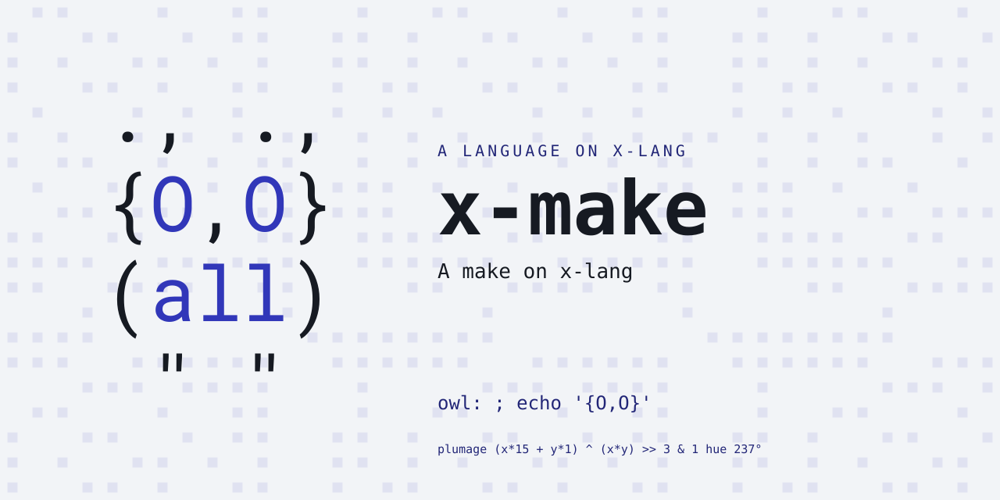
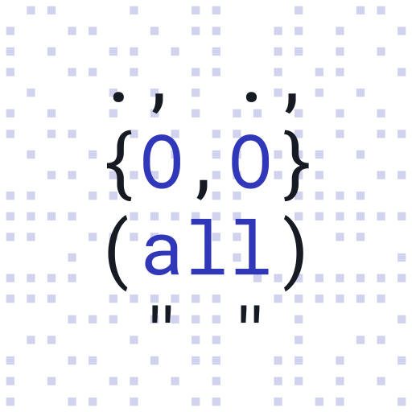

# x-make — make on x-lang

A make written in [x-lang](https://github.com/jonruttan/x-lang), loaded as
a lang. It requires no other lang.

    x -l make -- -C myproj            # default goal
    x -l make -- -C myproj -n all     # dry run
    x -l make -- -C myproj CC=clang   # override, locked

The aim is the middle ground between GNU make, BSD make and the others:
the readings they share, POSIX's where it has one, and on top of those
the readings one of them writes that a Makefile in the wild leans on.
A Makefile here should not need a reading only one of them has; when
one does, the Makefile moves, not this make.

## Status

No release has been cut. Paired with x-lang v0.53.0 (`lang.xon` is the
checkable row).

## What it does

- **Rules** with prerequisites and tab recipes; an explicit rule with no
  recipe takes an implicit one's.
- **Assignments:** `=`, `:=`, `?=`, `+=`, `!=`.
- **Expansion:** `$(VAR)`, `$X`, `$$`, computed names, and the suffix
  substitution `$(VAR:.c=.o)`.
- **Functions:** `shell`, `wildcard`, `findstring`, `if`, `subst`,
  `patsubst`, `basename`, `dir`, `notdir`, `strip`.
- **Conditionals:** `ifeq`, `ifneq`, `ifdef`, `ifndef`, `else`, `endif`.
- **`include`** and `-include`.
- **Implicit rules:** suffix rules (`.c.o:`, `.c:`, over `.SUFFIXES`) and
  pattern rules (`%.o: %.c`), with `$@ $< $^ $* $?`.
- **Special targets:** `.PHONY`, `.SILENT`, and a `FORCE:` prerequisite.
- **Variables.** `CC` defaults to `cc`. `SHELL` names the shell recipes
  run under: `/bin/sh` unless the makefile or the command line says
  otherwise, and the environment's `SHELL` is never read, as GNU make and
  BSD make leave it. The rest of the environment gives defaults the
  makefile overrides.
- **Backslash-newline** in POSIX's two readings: one space outside a
  recipe, kept inside one.
- **Rebuilds** by modification time, to the whole second.
- **Recipe prefixes:** `@` and `-`.
- **Options:** `-C`, `-f`, `-n`, `-s`, `-e`, `-i`, `-k`, and command-line
  `VAR=value` overrides, which lock.
- **Status** 0 or 2.

There is no chdir: `-C` prefixes paths and runs recipes under
`cd DIR &&`. `-w` is taken and does nothing, since this make never prints
a directory.

## GNU's readings that are read

These are read, and a Makefile in this project does not use them:

- `else ifeq` and its three siblings on one line;
- static pattern rules (`$(OBJS): %.o: %.c`);
- `$(sort)` and `$(MAKEFILE_LIST)`;
- a glob in any component of a `$(wildcard)` path, with `**` reading as
  `*` (one directory, as GNU's glob does);
- `--print-directory` and `--no-print-directory`, taken as `-w` is.

## Not supported

- `VPATH`, parallel `-j`, double-colon rules, `.IGNORE`, and the default
  variables other than `CC` (`CXX`, `AR`, `RM` and the rest) are not
  built.
- `define`, `export` and GNU's other `--long` options are GNU's alone,
  and are not planned.

## Install

It needs x-lang at the release `lang.xon` declares.

    make install        # into the x on PATH, with the make already there

## Running it

    x -l make -- [-C dir] [-f makefile] [-eikns] [VAR=value]... [target]...

`--` ends x's own options, so make's can follow it.

## Development

    make test           # the suite
    make check          # the suite against tests/contract/known-failures.txt

`(mk-run ARGV)` is the core, and `(%mk-expand TEXT VARS AUTOS)` is the
expansion the suite calls directly.

## Layout

    lang.xon          what the bundle is: lang, dialect, pairing, entry
    run.x             the entry
    mk/base.x         the parts, assembled
    mk/prims.x        the platform layer
    mk/expand.x       $(...) expansion: variables, automatics, functions
    mk/parse.x        the line interpreter: conditionals, assignments, rules
    mk/run.x          the graph walk, modification times, recipes
    mk/cli.x          options, overrides, and mk-main
    mk/syntax.x       the make highlighting grammar, for x/tool/syntax
    tests/            markdown specs, run by the platform's runner

## Licence

MIT No Attribution (MIT-0). See [LICENSE](LICENSE).

